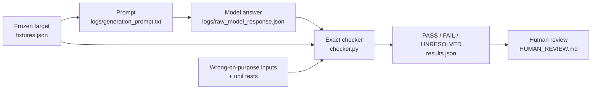

# A lattice workflow microtest: Z2 / Z2

This project is about a duality between M-theory on G₂ orbifolds of the form (T³ × T⁴/G)/K, where K is an extra symmetry, and the heterotic string on an orbifolded six-torus T⁶. The aim is to classify these geometries and, for each one, find heterotic shift data that reproduce the same physics. This repository tests the workflow on the smallest case, G = K = Z2. An AI model proposes the shift data and exact code checks it.

The workflow is meant to be careful about how the model is used, in five steps:

1. state the target precisely, before asking anything;
2. ask the model for a concrete proposal, and keep its exact answer;
3. check that answer with small, exact, deterministic code instead of trusting it;
4. test the checker itself on inputs that are wrong on purpose;
5. leave the physics judgement to a human reviewer.

The physics example is deliberately small. Nothing here claims a new result or a verified dual pair.



## The question, in plain terms

On the M-theory side, the K3 factor of the geometry is the orbifold `T4/G` with `G = Z2`. It has **16 singular points**, each of type `A1`. A second `Z2` symmetry (called `K`) acts on top of it. In the main example, `K` maps every one of the 16 singular points to itself.

Each of these 16 local pieces should end up as one of two types, **Higgs-type** or **Coulomb-type**. The target for the main example is **one Higgs-type and fifteen Coulomb-type** components.

On the heterotic side, the same symmetry is described by a set of **shift data**: rational numbers saying how the symmetry acts on the gauge lattice, on the torus, and on the right-moving coordinates. The model was asked to propose shift data that

- produce the 1 Higgs + 15 Coulomb pattern on a chosen set of 16 abstract `A1` root pairs, and
- satisfy a few exact arithmetic consistency conditions within a declared, **conditional** ansatz (`E8(-1) + U + U`).

The checker then recomputes everything from the proposed numbers.

## The ingredients

Each input in `fixtures.json` (and the model's answer) is a small record with these fields:

| Field | Meaning | Main example |
| --- | --- | --- |
| `geometry_action` | Which `K` action is used, and therefore how the 16 singular points are permuted | `all_fixed`: `(z1,z2) -> (-z1,z2)`, all 16 fixed |
| `target` | What the input claims: fixed points, exchanged pairs, and which component is Higgs-type | 16 fixed, 0 exchanged, Higgs at index 6 |
| `V` | Gauge shift: 8 rational coordinates in the first `E8`. The second `E8` is untouched | `(0,0,0,0,0,0,1/4,1/4)` |
| `delta` | Torus shift in `U + U`: a compensating pair, then an external half-translation | `(1/4,1/4; 0,1/2)` |
| `phi` | Right-moving twist, fixed by the ansatz | `(1/2,1/2,0)` |
| `N` | Declared order of the whole shift | `4` |

**How the Higgs/Coulomb pattern comes out of `V`.** The 16 `A1` factors are represented by root pairs `e1±e2, e3±e4, e5±e6, e7±e8` (eight in the first `E8`) plus eight more in the untouched second `E8`. For each root `r`, the phase `exp(2πi r·V)` is computed. Phase `-1` marks a Higgs-type component and phase `+1` marks a Coulomb-type component. With the `V` above, only `e7+e8` gets phase `-1`: in zero-based numbering, that is index 6. Which geometric singular point "index 6" stands for is a bookkeeping choice, not a constructed map.

## What the checker checks

`checker.py` uses only exact fractions, never floating point, and computes every result from the supplied numbers.

| Check | In plain terms |
| --- | --- |
| `geometry_target` | Does the chosen `K` action really give the claimed numbers of fixed and exchanged singular points? |
| `gauge_lattice_membership` | Is `N·V` a vector of the `E8` lattice? |
| `torus_lattice_membership` | Is `N·delta` integral in the `U + U` basis? |
| `declared_shift_order` | Is the declared `N` the actual order of the shift? For example, `2V` is *not* in `E8` but `4V` is, so the order is 4, not 2. |
| `external_translation` | Is the external part of `delta` the fixed half-translation of the ansatz? |
| `right_twist_assignment` | Is `phi` the frozen value `(1/2,1/2,0)`? |
| `local_root_action` | Do the root phases produce exactly the claimed Higgs/Coulomb pattern? |
| `local_projected_dimensions` | Do the local field counts come out right? For the main example: 46 vectors and scalar dimensions `(46,2,2)`. |
| `level_matching` | Does the one written congruence hold? `N²(q_V + q_delta − q_phi)` must be a multiple of `2N`. For the main example: `16·(−1/8 + 1/8 − 1/2) = −8`, a multiple of 8. |

Three further checks are **always UNRESOLVED**, because this demo does not implement them yet:

- `narain_embedding`: the full Narain lattice, its gluing, moduli and Wilson lines;
- `operator_lift`: the vertex-operator lift and consistency in all sectors;
- `complete_spectrum_branch_match`: the complete massless spectrum and its match to the branches.

As a result, **no input can ever reach an overall PASS**. That is intentional.

## The six inputs

| Input | Role | What should happen |
| --- | --- | --- |
| `one_higgs_reference` | The main example | All implemented checks pass; overall UNRESOLVED |
| `all_coulomb_control` | Trivial control (`V = 0`, `N = 2`) | All implemented checks pass; overall UNRESOLVED |
| `seeded_geometry_mismatch` | Wrong on purpose: uses a `K` action that fixes no points | Fails `geometry_target` |
| `seeded_wrong_order` | Wrong on purpose: declares `N = 2` | Fails `declared_shift_order` |
| `seeded_lattice_failure` | Wrong on purpose: `4V` is not in `E8` | Fails `gauge_lattice_membership` |
| `seeded_level_matching_failure` | Wrong on purpose: a different torus shift | Fails `level_matching` (residue 4 instead of 0) |

The four "seeded" inputs test the checker. They are not mistakes the model made. These are six checking inputs, not six physical models.

## Where the proposal comes from

No code in this repository calls a model. The proposal was produced **once, by hand, outside the repository**, and only its saved answer is used here:

1. The prompt in `logs/generation_prompt.txt` was given to a fresh **Codex** agent session (OpenAI). The agent was told not to look at any files, the internet or other agents, and it answered without tool calls.
2. Its reply, a single JSON object with `V`, `delta`, `N`, `phi`, a short `reasoning` and a list of `limitations`, was saved unchanged as `logs/raw_model_response.json`.
3. `verify_proposal.py` (and cell 1 of the notebook) read that file and run it through the checker. The result is `logs/proposal_checks.json`: all nine implemented checks PASS; overall UNRESOLVED.

Asking again, or asking another model, will not necessarily give the same text or numbers. That is why the answer is archived, and why only the deterministic checks on it are claimed to be reproducible.

`logs/review_log.json` records the rest of the history. The numeric proposal was accepted without changes. One sentence of the model's explanation (which local field signs belong to which generators) was corrected in a step recorded as "Assistant review", without changing any numbers. The implementation was checked in a "Separate assistant review". **No human scientific review has been done yet**; see `HUMAN_REVIEW.md`. The model's own `limitations` field in the response is worth reading too.

### Try another model

1. Paste the contents of `logs/generation_prompt.txt` into any model.
2. Save its JSON reply to a file, for example `my_answer.json`. A surrounding ```` ```json ```` code fence is fine.
3. Check it without touching the archived files:

   ```bash
   python3 verify_proposal.py --proposal my_answer.json
   ```

   This prints the overall verdict and writes the full check record to `my_answer.checks.json`. Use `--output` to choose another location. The command exits with status 1 if any implemented check fails, and with status 2 if the file can't be read or lacks `N`, `V`, `delta` or `phi`.

Decimal numbers such as `0.25` are rejected on purpose; the answer must use exact strings like `"1/4"`.

## Run it

From the repository root (or an extracted archive), using Python 3.8 or later (tested on 3.8.10). Nothing needs to be installed:

```bash
python3 checker.py            # evaluates the six inputs and writes results.json
python3 -m unittest -v        # runs the 16 tests of the checker
python3 verify_proposal.py    # checks the model's archived answer, writes logs/proposal_checks.json
```

Expected summary from `checker.py`:

| Measure | Expected |
| --- | ---: |
| Fixtures evaluated | 6 |
| Execution errors | 0 |
| Pass within the implemented checks | 2 |
| Fail within the implemented checks | 4 |
| Overall unresolved | 2 |
| Overall fail | 4 |
| Verified duals | 0 |

The checker also runs two side calculations. A geometric preflight recovers `(fixed components, exchanged pairs) = (16,0), (0,8), (4,6)` for the three `K` actions considered. A finite scan tries all 16 torus shifts `delta = (a/4, b/4; 0, 1/2)` for the main example and finds that `(1,1)` and `(3,3)` satisfy the congruence; for the control, `(1,1)` is the only one of four. These are counts of raw arithmetic solutions, not of physically different constructions.

## What the status words mean

- **PASS**: a named, implemented check passed, within its stated scope.
- **FAIL**: the computation contradicts a requirement of the frozen input.
- **UNRESOLVED**: the check is not implemented here, or physical information is missing.
- **ERROR** (`execution_status`): the input was malformed or the code could not run. This is a software problem, not a physics result.

A reference input therefore has `scoped_status: PASS` and `overall_status: UNRESOLVED`. Passing one level-matching congruence does not establish full modular invariance or a dual pair. A failed seeded input shows only that its one stated check fails.

## What's in the repository

**Run and check**
- `checker.py`: the exact checks.
- `test_checker.py`: tests with independently computed expected values, kept separate from the checker.
- `fixtures.json`: the six inputs.
- `results.json`: the checker's deterministic output.
- `verify_proposal.py`: runs the model's archived answer through the checker, or any other answer with `--proposal`.

**The model interaction**
- `logs/generation_prompt.txt`: the exact prompt.
- `logs/raw_model_response.json`: the model's unchanged answer.
- `logs/review_log.json`: provenance and review status.
- `logs/proposal_checks.json`: the checker's verdict on that answer.

**Read**
- `demo.ipynb`: an eight-cell worked example with saved outputs. Jupyter is optional: install it from `requirements-optional.txt`, start it in this folder and run all cells.
- `PLAYBOOK.md`: the full proposal, check and review procedure.
- `report/Z2_workflow_demo_report.pdf`: the LaTeX report. Rebuild it with `bash compile_report.sh` (needs XeLaTeX); the fonts and their licence are included.

**Review and integrity**
- `HUMAN_REVIEW.md`: the scientific review checklist, currently pending.
- `VALIDATION.md`: the maintainer's tested environment and rerun results.
- `MANIFEST.sha256`: checksums of all files (`sha256sum -c MANIFEST.sha256`).
- `CITATION.cff`: how to cite this repository.

## Reproductions

To report an independent rerun, provide the commit hash (or archive hash), Python version, operating system, commands used, test output and the SHA-256 hash of the regenerated `results.json`. State whether you used only these instructions, whether any changes were necessary, and whether you reviewed the physics assumptions or only reproduced the computations. Submit it through the repository's **Reproduction report** issue form. The maintainer's own rerun is recorded in `VALIDATION.md`.

No external reproduction or independent human scientific approval is claimed. The pending review sheet makes this explicit.

## Authorship and attribution

This repo was prepared by **Lucía Cabrera**.

The geometric targets, the local branch interpretation and the level-matching relation come from ongoing, unpublished work by Bobby Acharya, Daniel Baldwin, Lucía Cabrera and Kumar Narain.

To cite this repository, see `CITATION.cff`.
